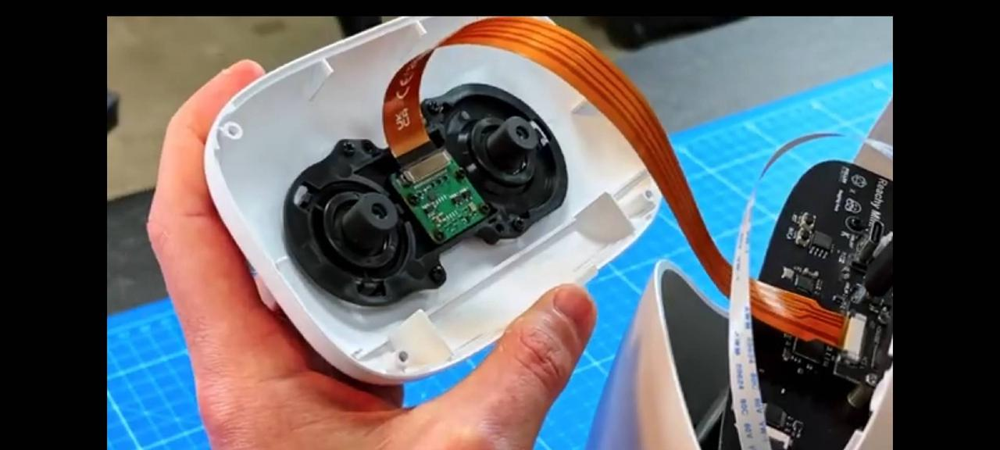
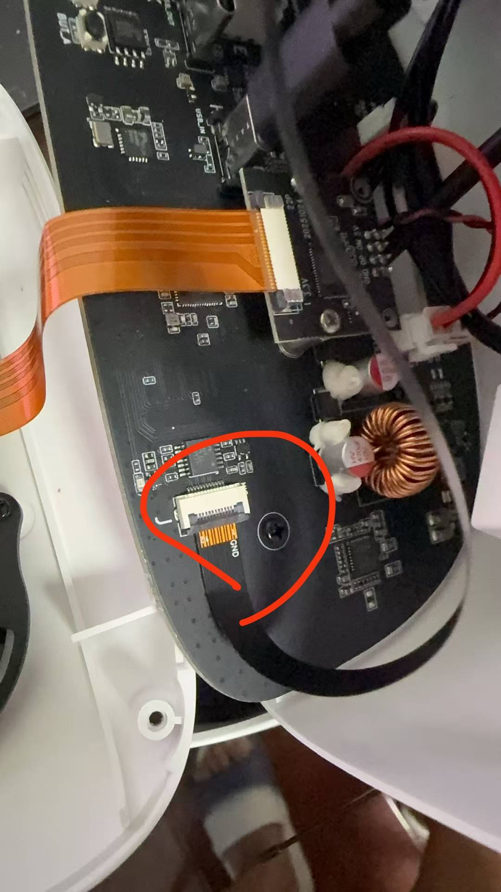
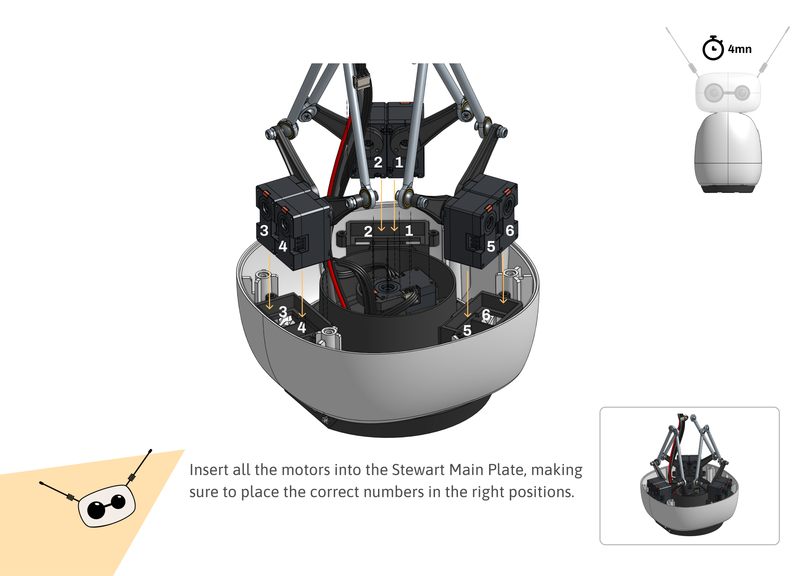
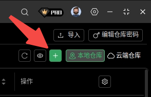
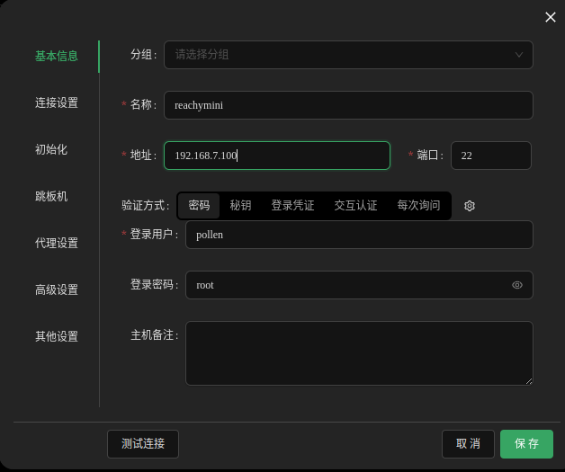
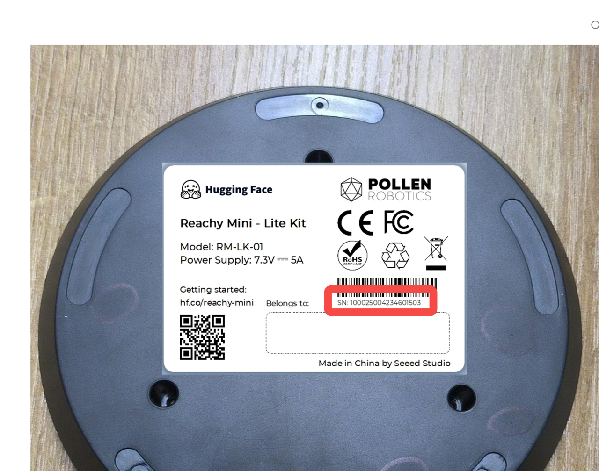
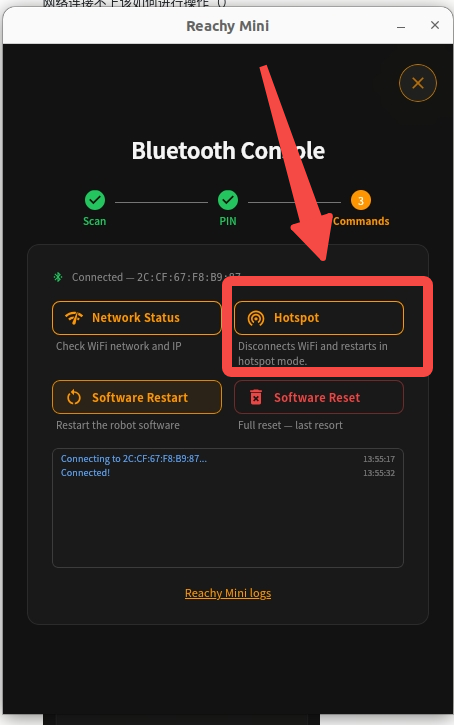
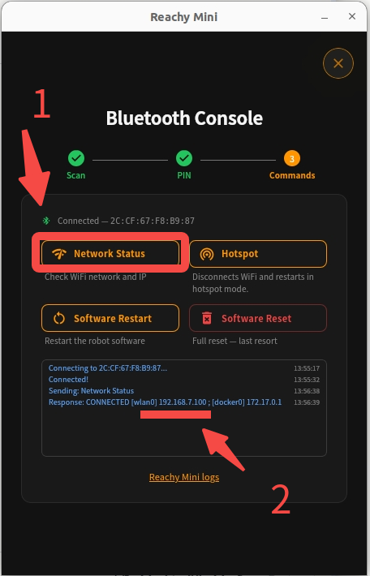
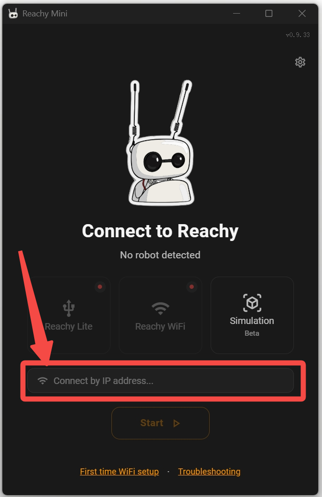

一、摄像头排障
1.使用不了，检查接线正反，正确接线如下：

2.接线正常后仍然不行：
升级机器人固件和app版本到最新版本
app版本在进入应用时会有提示进行更新，机器人固件在进入app后的设置里面可以进行更新

3.更新后仍然不行：
无线版：
首先需要关掉app应用，防止app程序占用摄像头，而后ssh进入reachymini，再终端上输入reachyminios_check进行自检查看摄像头的日志输出是否正常

有线版：
用usb线将reachymini与电脑连接，此时需要关掉app应用，防止app程序占用摄像头，windows设置里面搜索摄像头看是否有reachymini的画面

4.完成以上排查后仍然不行则将1,2,3步骤截图，以及将机器人底部的SN码提供给技术人员进行补发

涉及的sku:
摄像头sku：114993030
摄像头线束sku：100093903

二、麦克风排障:
1.首先检查接线，如图所示此种接线是错误的，带有GND的面应该朝下

2.接线正常后仍然不行：
升级机器人固件和app版本到最新版本
app版本在进入应用时会有提示进行更新，机器人固件在进入app后的设置里面可以进行更新

3.更新后仍然不行：
无线版：
首先需要关掉app应用，防止app程序占用摄像头，而后ssh进入reachymini，再终端上输入reachyminios_check进行自检查看麦克风的日志输出是否正常

4.完成以上排查后仍然不行则将1,2,3步骤截图，以及将机器人底部的SN码提供给技术人员进行补发

涉及的sku:
麦克风sku：100018615

三、舵机排障：
首先检查舵机是否安装正确
参考

四、如何进行ssh连接到机器人内部：

1.用户名：pollen
密码：root

2.查询ip
reachymini的app上可以查询ip（以192.168开头）

3.reachymini和电脑应该连接在同一个wifi下，对于会使用ssh的直接在终端上ssh pollen@ip即可
对于不会使用ssh的可以下载https://www.xterminal.cn/
下载后，跳过注册，在右上角

如图所示，点击保存后，按下连接，即可进入到reachymini的内部终端

4.开启虚拟网卡会导致ssh无法连接

五、reahymini应用下载的链接
1.电脑版
最新版本选择相应的windows/macos/Linux进行安装:https://pollen-robotics.com/reachy-mini/download/
过往版本：https://github.com/pollen-robotics/reachy-mini-desktop-app/releases

2.手机版
（仅支持Wireless版本）
目前支持苹果系统和安卓系统
可分别在App Store和Google Play中进行下载https://pollen-robotics.com/reachy-mini/download/
手机版使用教程https://pollen-robotics.com/reachy-mini/blog/software-stack/

六、安装视频
视频
https://pollen-robotics.com/reachy-mini/getting-started/
图文
https://huggingface.co/spaces/pollen-robotics/Reachy_Mini_BETA_Assembly_Guide

七、无线版本的reachymini的wifi连接不上，reachymini的热点连接不上
1.如若连接校园网等公共网络、需要验证的网络是无法连接成功的，如若没有稳定的wifi，可以考虑使用个人手机热点进行连接
2.使用蓝牙进行连接，按下如图的按钮后重置网络信息
提示输入PIN码时

点击此处进行重置网络

而后机器人断电重启，app也需要同步重新打开
3.如若机器人连接上了wifi但是卡在最后一步进不去，使用蓝牙连接获取ip

此时获取到ip后可以回到主页进行ip登陆

4.重启机器人和app多尝试几次

八、reachymini的usb作用
对于无线版reachymini：usb口可以扩展加入usb音箱等usb设备，无线版无法通过usb进行连接
有线版reachymini：usb口是reachymini和电脑连接的工具

九、教程案例：
1.接入豆包等国产大模型，Home Assistant 集成，Reachy Mini 语音控制机械臂，Reachy Mini × XIAO 屏幕体感控制等开发教程可以参考seeed的wiki页面https://wiki.seeedstudio.com/cn/reachymini_getting_started/

2.huggingface官方教程：https://huggingface.co/docs/reachy_mini/index

十、huggingface登陆不进去，一做表情就会断连，无法在应用商店进行下载应用，更新不了app
需要科学上网，有线版本的reachymini只需要在电脑上进行科学上网，对于无线版的reachymini需要在reachymini内部科学上网
可以使用AI进行配置科学上网，将以下指令交给AI:
推荐使用codex，我需要配置reachymini内部的科学上网使得我可以使用reachymini的app应用，给我远程进入reachymini内部配置一下，用户名：pollen，密码：root，ip是(这个需要自我先进行查询)
